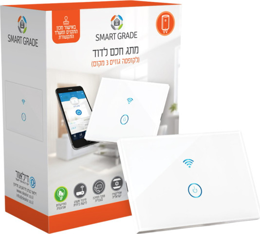

<div align="center">

# SmartGrade Secure for Home Assistant

**Control and monitor your SmartGrade (IoTech Verticals / Dealor) smart switches from Home Assistant.**

**English** | [עברית](README.md)

[](https://my.home-assistant.io/redirect/hacs_repository/?owner=sobelman&repository=ha-smartgrade&category=integration) [](https://github.com/sobelman/ha-smartgrade/actions/workflows/validate.yaml) [](https://github.com/sobelman/ha-smartgrade/actions/workflows/tests.yaml) [](LICENSE) [](https://github.com/sobelman/ha-smartgrade/releases)



</div>

> [!WARNING]
> This is an **unofficial**, community-made integration. It is not affiliated with, endorsed by, or supported by IoTech Verticals or Dealor. See the [Disclaimer](#disclaimer).

## About

**SmartGrade Secure** is the Android/iOS app for the Wi-Fi smart switches made by **IoTech Verticals** and sold in Israel by **Dealor (דילאור)**, best known for the smart **boiler (dud shemesh) switch** with a glass touch panel. The devices only talk to the vendor's cloud; there is no local API.

This integration (domain `smartgrade`) logs in to the same cloud the app uses, with your phone number and an SMS code, and adds your devices to Home Assistant: you can switch them on and off, read live power, current and voltage, and use them in automations, dashboards and the Energy dashboard (via a Riemann-sum helper).

## Features

- ✅ UI setup: phone number → SMS code. No YAML.
- ✅ One **switch** entity per relay (1–3 relays per device).
- ✅ **Power (W)**, **current (A)**, **voltage (V)** and **power factor** sensors for every device that reports metering, plus **phase 2 / phase 3 power** on 3-phase devices.
- ✅ **Read-only timers**: how many timers are enabled, and for each one its name, kind, days, on/off times and relays.
- ✅ **Next scheduled action**: when it runs and what it does (on/off), plus the list of upcoming actions.
- ✅ Diagnostics: **Wi-Fi signal strength**, **firmware version**, **firmware update pending**, **online/offline**, **last reading time**, **maximum on time**, **MAC address** and **device type**.
- ✅ Devices grouped by unit, with model, firmware version and MAC address.
- ✅ Works with every vendor product type, not just the boiler switch: devices with 1–3 relays get switches, and every device gets diagnostic sensors.
- ✅ Entities become *unavailable* when the cloud reports the device offline (the connectivity sensor itself stays available and shows *disconnected*).
- ✅ Simple re-sign-in when the vendor's 30-day login expires ([why](#%EF%B8%8F-signing-in-again-once-a-month)).
- ✅ Downloadable diagnostics with the token and phone number redacted.
- ✅ English and Hebrew translations.

## Supported devices

The integration works with every `product_id`: each device gets the right model name, diagnostic sensors and (if it reports them) metering sensors. Devices with relays get one switch per relay. Only **product 8, boiler switch (Gewiss 3-module)** has been tested live; the others use the same API but are untested. Please [open an issue](https://github.com/sobelman/ha-smartgrade/issues) with your results.

| product_id | Device | What you get | Status |
|---|---|---|---|
| 8 | Boiler switch (Gewiss 3-module) | Switch, metering, timers, diagnostics | ✅ Tested |
| 6 | Boiler switch (under plaster) | Switch, metering, timers, diagnostics | 🟡 Untested |
| 7 | Wi-Fi switch (box 55) | Switch, metering, timers, diagnostics | 🟡 Untested |
| 2, 5, 16, 17 | Smart sockets and adapters | Switch, metering, timers, diagnostics | 🟡 Untested |
| 9–13 | Light switches (1–3 gangs) | One switch per gang, timers, diagnostics | 🟡 Untested |
| 14, 22 | 1-phase DIN-rail switches (16A, 63A) | Switch, metering, timers, diagnostics | 🟡 Untested |
| 15 | 3-phase DIN-rail switch | Switch, metering incl. phase 2/3, timers, diagnostics | 🟡 Untested |
| 23 | Smart power meter | Metering (incl. phase 2/3), diagnostics | 🟡 Untested |
| 18, 19, 36 | Shutters | Diagnostics only | 🟠 Partial |
| 20, 24, 25, 30, 35 | A/C panel / IR | Diagnostics only | 🟠 Partial |
| 26–29, 31 | Sensors (motion, leak, smoke, gas, temp/humidity) | Diagnostics only | 🟠 Partial |
| 21 | Zigbee gateway | Diagnostics only | 🟠 Partial |
| other | Unknown product | Diagnostics, plus switches if the cloud reports a relay | 🟡 Untested |

**Shutters:** shutter control is not supported yet. Diagnostic sensors are available; a cover entity will be added in a later release once the behaviour is confirmed on a real shutter.

## Requirements

- Home Assistant **2025.2** or newer.
- A SmartGrade Secure account with at least one device, and the phone that receives its SMS codes.
- Internet access from Home Assistant (cloud only).

## Installation

### HACS (recommended)

The integration is in the HACS default list. Search for it and install it directly; there is no need to add a custom repository.

In newer versions of Home Assistant, HACS may appear in the sidebar as **Marketplace**.

1. Open **HACS** (or **Marketplace** in the sidebar).
2. Search for **SmartGrade**.
3. Click **Download**, then **restart** Home Assistant.
4. Go to **Settings → Devices & services → Add integration** and search for **SmartGrade**.

You can also open it in HACS with this button:

[](https://my.home-assistant.io/redirect/hacs_repository/?owner=sobelman&repository=ha-smartgrade&category=integration)

### Manual

1. Download the [latest release](https://github.com/sobelman/ha-smartgrade/releases).
2. Copy the `custom_components/smartgrade` folder into your Home Assistant `config/custom_components/` folder, so that you have `config/custom_components/smartgrade/manifest.json`.
3. **Restart** Home Assistant.

## Configuration

[](https://my.home-assistant.io/redirect/config_flow_start/?domain=smartgrade)

1. **Settings → Devices & services → Add integration**, search for **SmartGrade Secure**.
2. Enter the phone number registered in the SmartGrade Secure app, in the same format you use in the app (`05XXXXXXXX`). An SMS is sent to it.
3. Enter the SMS code. Your devices appear right away.

<!-- SCREENSHOTS PLACEHOLDER: add images/config-step-phone.png, images/config-step-code.png and
images/device-page.png, then replace this comment with:
| Step 1: phone number | Step 2: SMS code | Result |
|---|---|---|
|  |  |  |
-->
> 📸 *Screenshots of the setup flow are coming soon.*

There are no options to set. State is polled every 30 seconds; the cloud refreshes power readings about once a minute.

## ⚠️ Signing in again once a month

> [!IMPORTANT]
> ⚠️ **About once a month, you'll need to sign in again with an SMS code.** It takes about 20 seconds. This is a known limitation of the vendor's service, not a bug.

SmartGrade's cloud keeps you signed in for **30 days** at a time. After that, it asks for a new SMS code. This is how the vendor built the service: there is no way to extend the sign-in or renew it automatically, and the official SmartGrade app works the same way.

So, about once a month:

1. Home Assistant shows a notification that SmartGrade needs you to sign in again (under **Settings**).
2. Open it and press **Submit**. An SMS code is sent to your phone.
3. Type in the code. That's it.

Until you do, your SmartGrade entities show as *unavailable* in Home Assistant. The devices themselves, and any timers you set in the app, keep working as usual.

## Entities

For a device named *Boiler* (example IDs; the real ones depend on the device name and your system language):

| Entity | Example ID | Description |
|---|---|---|
| Switch | `switch.boiler` | Relay 1. Additional relays: `switch.boiler_relay_2`, `…_relay_3`, or the per-relay names set in the app. |
| Power | `sensor.boiler_power` | Live power draw, W. |
| Power phase 2 / 3 | `sensor.boiler_power_phase_2`, `…_phase_3` | Power on phases 2 and 3, W. Enabled by default only on 3-phase products (15, 23). |
| Current | `sensor.boiler_current` | Live current, A. |
| Voltage | `sensor.boiler_voltage` | Mains voltage, V. |
| Power factor | `sensor.boiler_power_factor` | Power factor (0–1). |
| Timers | `sensor.boiler_timers` | **Read-only.** State: number of enabled timers. Attributes: every timer with name, enabled, kind (`recurring`/`normal`/`pattern`/`off_on`), days, on/off times or on/off minutes, date range and relays. |
| Next scheduled action | `sensor.boiler_next_scheduled_action` | **Read-only.** When the next scheduled action runs; attributes: what it does (on/off), which relays, and up to 10 upcoming actions. |
| Connectivity | `binary_sensor.boiler_connectivity` | Diagnostic. Whether the cloud sees the device online. |
| Firmware update pending | `binary_sensor.boiler_firmware_update_pending` | Diagnostic. The cloud's `upgradeNow` flag (exact meaning not verified). |
| Signal strength | `sensor.boiler_signal_strength` | Diagnostic. Wi-Fi RSSI, dBm. |
| Firmware | `sensor.boiler_firmware` | Diagnostic. |
| Last reading | `sensor.boiler_last_reading` | Diagnostic. When the device last sent a metering reading. |
| Maximum on time | `sensor.boiler_maximum_on_time` | Diagnostic. The device's safety limit (`max_on_min`), in minutes. |
| MAC address | `sensor.boiler_mac_address` | Diagnostic. The device's cloud id is its MAC address. |
| Device type | `sensor.boiler_device_type` | Diagnostic. Product type (translated), with `product_id` as an attribute. |

Sensors are only created when the cloud returns a value for them, so a device that doesn't report a field won't get an empty entity. Timers and the next action are refreshed every 5 minutes, and right after a switch command.

**Not exposed by the cloud:** the IP address and the Wi-Fi network name (SSID) are **not** available from the vendor's API, so they can't be shown. Account details (name, phone, email) are intentionally not shown either.

**Energy dashboard:** the cloud's live reading has no kWh counter. The cloud does have a consumption history (`/kwh`), but its units and meaning have not been verified against a real device yet, so it is not exposed. Until then, create an *Integral (Riemann sum)* helper from `sensor.boiler_power` (method *left*, unit prefix *k*) and add it to the Energy dashboard.

## Important notes

- **A new SMS code is needed every 30 days.** See [Signing in again once a month](#%EF%B8%8F-signing-in-again-once-a-month).
- **Possible conflict with the phone app.** It has not been confirmed whether a new login from Home Assistant signs the phone app out (or the reverse). If your app suddenly asks you to log in again, that is probably why; both can be logged in again afterwards.
- **Cloud only.** Devices cannot be controlled locally. If the vendor's cloud or your internet connection is down, the entities become unavailable.
- **Timers and scenes** you set in the app keep running in the cloud, even when Home Assistant is off. The integration **shows** timers and the next action, but **never** creates, changes or deletes them.
- Switch commands are sent through the cloud; the state shown is re-read from the cloud a moment later.

## Troubleshooting

| Problem | What to do |
|---|---|
| *"The SmartGrade cloud rejected this phone number"* | Use the exact number registered in the app, in `05XXXXXXXX` format. |
| No SMS arrives | Wait a minute and try again; check the number. Too many requests may be throttled by the vendor. |
| *"The SMS code is wrong or has expired"* | Codes are single use and short-lived. Go back and request a new one. |
| Entities unavailable | Check the device is online in the SmartGrade app, and that Home Assistant has internet access. |
| Asked to sign in again | Normal, once every 30 days. See [Signing in again once a month](#%EF%B8%8F-signing-in-again-once-a-month). |
| No power sensors | The device does not report metering (not every model has a meter). |

**Debug logging:** add this to `configuration.yaml`, restart, reproduce the problem and attach the log to an issue (check it for personal data first):

```yaml
logger:
  logs:
    custom_components.smartgrade: debug
```

You can also download diagnostics from **Settings → Devices & services → SmartGrade Secure → ⋮ → Download diagnostics**; the token and phone number are redacted automatically.

## Disclaimer

- This project is **not affiliated with, endorsed by, or supported by IoTech Verticals Ltd. or Dealor**. "SmartGrade" and related names and logos are trademarks of their respective owners and are used here only to describe compatibility.
- The vendor publishes no API. This integration uses the private cloud API of the official app, found through interoperability research, and may stop working at any time if the vendor changes it.
- To talk to that API it uses the **app-level client credential that is embedded in the official app** (the same for every user). It is not a personal secret, but the vendor could revoke or rotate it at any moment, which would break the integration until it is updated.
- Your phone number and the 30-day token are stored only in your Home Assistant configuration and are sent only to the vendor's cloud (`api.iotechv.com`).
- These devices often switch high-power loads such as water heaters. Use automations responsibly. The software is provided "as is", without warranty of any kind; see the [LICENSE](LICENSE).

## Contributing

Contributions are welcome, especially reports from owners of models other than the boiler switch.

1. Fork the repository and create a branch.
2. Set up a dev environment: `python -m venv .venv && . .venv/bin/activate && pip install -r requirements_test.txt`.
3. Run `ruff check . && ruff format --check . && pytest`. The tests use recorded responses only; **never** add tests that call the real cloud or switch a real device.
4. Open a pull request.

Technical background: [findings.md](findings.md) (reverse-engineering notes) and [VERIFIED.md](VERIFIED.md) (what was verified against the live service). Publishing steps: [PUBLISHING.md](PUBLISHING.md).

## License

[MIT](LICENSE) © 2026 sobelman
