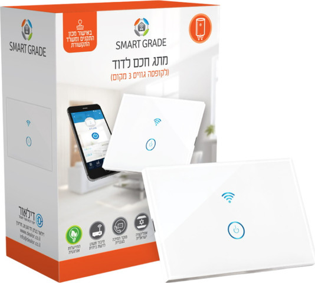

<div align="center" dir="rtl">

# SmartGrade Secure ל-Home Assistant

**שליטה וניטור של המפסקים החכמים של SmartGrade (IoTech Verticals / דילאור) מתוך Home Assistant.**

[English](README.en.md) | **עברית**

[](https://my.home-assistant.io/redirect/hacs_repository/?owner=sobelman&repository=ha-smartgrade&category=integration)
[](https://github.com/sobelman/ha-smartgrade/actions/workflows/validate.yaml)
[](https://github.com/sobelman/ha-smartgrade/actions/workflows/tests.yaml)
[](LICENSE)
[](https://github.com/sobelman/ha-smartgrade/releases)



</div>

<div dir="rtl">

> [!WARNING]
> זוהי אינטגרציה **לא-רשמית** שנבנתה על ידי הקהילה. היא אינה קשורה ל-IoTech Verticals או לדילאור, ואינה נתמכת או מאושרת על ידן. ראו [הסתייגות](#הסתייגות).

## על הפרויקט

**SmartGrade Secure** היא האפליקציה (אנדרואיד/iOS) של המפסקים החכמים מבוססי Wi-Fi של **IoTech Verticals**, שנמכרים בישראל על ידי **דילאור**. המוצר המוכר ביותר הוא **המתג החכם לדוד** עם פאנל מגע מזכוכית. המכשירים מדברים רק עם הענן של היצרן, ואין להם ממשק מקומי.

האינטגרציה (domain: `smartgrade`) מתחברת לאותו ענן שהאפליקציה משתמשת בו, עם מספר הטלפון שלך וקוד SMS, ומוסיפה את המכשירים ל-Home Assistant: אפשר להדליק ולכבות אותם, לקרוא הספק, זרם ומתח בזמן אמת, ולהשתמש בהם באוטומציות, בדשבורדים ובלוח האנרגיה (דרך עזר Riemann sum).

## יכולות

- ✅ הגדרה מלאה מהממשק: מספר טלפון ← קוד SMS. בלי YAML.
- ✅ ישות **switch** לכל ממסר (1–3 ממסרים למכשיר).
- ✅ חיישני **הספק (W)**, **זרם (A)** ו**מתח (V)** לכל מכשיר שמדווח צריכה.
- ✅ חיישן אבחון של **עוצמת קליטת Wi-Fi** (כבוי כברירת מחדל).
- ✅ כל מכשיר מופיע כמכשיר נפרד עם דגם וגרסת קושחה.
- ✅ הישויות הופכות ל*לא זמינות* כשהענן מדווח שהמכשיר מנותק.
- ✅ התחברות מחדש פשוטה כשתוקף ההתחברות (30 יום, מגבלה של היצרן) פג ([למה](#%EF%B8%8F-התחברות-מחדש-פעם-בחודש)).
- ✅ קובץ אבחון להורדה, שבו הטוקן ומספר הטלפון מוסתרים.
- ✅ תרגום לאנגלית ולעברית.

## מכשירים נתמכים

מכשירים עם ממסר מוצגים כמתגים. נבדק בפועל: **מוצר 8, מתג לדוד (גוויס 3 מקום)**. שאר הדגמים משתמשים באותו API וצפויים לעבוד. נשמח אם [תפתחו issue](https://github.com/sobelman/ha-smartgrade/issues) עם התוצאות.

| product_id | מכשיר | סטטוס |
|---|---|---|
| 8 | מתג לדוד (גוויס 3 מקום) | ✅ נבדק |
| 6 | מתג לדוד (תחת הטיח) | 🟡 צפוי לעבוד |
| 7 | מתג Wi-Fi (קופסה 55) | 🟡 צפוי לעבוד |
| 2, 5, 16, 17 | שקעים חכמים | 🟡 צפוי לעבוד |
| 9–13 | מפסקי תאורה (1–3 מפסקים) | 🟡 צפוי לעבוד |
| 14, 15, 22 | מפסקי דין (חד-פאזי, תלת-פאזי, 63A) | 🟡 צפוי לעבוד |
| 18, 19, 36 | תריסים | ❌ עדיין לא נתמך |
| 20, 24, 25, 30, 35 | תרמוסטט / IR / מזגן | ❌ עדיין לא נתמך |
| 26–29, 31 | חיישנים | ❌ עדיין לא נתמך |
| 21 | גייטוויי Zigbee | ❌ לא נתמך |

## דרישות

- Home Assistant בגרסה **2025.2** ומעלה.
- חשבון SmartGrade Secure עם מכשיר אחד לפחות, והטלפון שמקבל את קודי ה-SMS שלו.
- גישה לאינטרנט מ-Home Assistant (ענן בלבד).

## התקנה

### דרך ה-Marketplace או HACS (מומלץ)

לחצו על הכפתור. ב-Home Assistant **2026.11 ומעלה** הוא פותח את המאגר ב-**Marketplace** המובנה (הגדרות ← Marketplace); בגרסאות ישנות יותר הוא פותח את **HACS**. בשני המקרים תוצע הוספה כמאגר מותאם אישית, ואז לוחצים **Download** ומפעילים מחדש.

[](https://my.home-assistant.io/redirect/hacs_repository/?owner=sobelman&repository=ha-smartgrade&category=integration)

או ידנית ב-HACS:

1. פתחו את **HACS** ← ⋮ (למעלה מימין) ← **Custom repositories**.
2. כתובת המאגר: `https://github.com/sobelman/ha-smartgrade`, סוג: **Integration** ← **Add**.
3. חפשו **SmartGrade Secure**, פתחו ולחצו **Download**.
4. **הפעילו מחדש** את Home Assistant.

### התקנה ידנית

1. הורידו את [הגרסה האחרונה](https://github.com/sobelman/ha-smartgrade/releases).
2. העתיקו את התיקייה `custom_components/smartgrade` לתיקייה `config/custom_components/` של Home Assistant, כך שיתקבל `config/custom_components/smartgrade/manifest.json`.
3. **הפעילו מחדש** את Home Assistant.

## הגדרה

[](https://my.home-assistant.io/redirect/config_flow_start/?domain=smartgrade)

1. **הגדרות ← מכשירים ושירותים ← הוספת אינטגרציה**, וחפשו **SmartGrade Secure**.
2. הזינו את מספר הטלפון הרשום באפליקציה, באותו פורמט שבו אתם מתחברים לאפליקציה (`05XXXXXXXX`). יישלח אליו SMS.
3. הזינו את הקוד. המכשירים יופיעו מיד.

<!-- מקום לצילומי מסך: הוסיפו את images/config-step-phone.png, images/config-step-code.png ו-images/device-page.png
והחליפו את ההערה הזו בטבלת תמונות. -->
> 📸 *צילומי מסך של תהליך ההגדרה יתווספו בקרוב.*

אין אפשרויות נוספות להגדיר. המצב מתעדכן כל 30 שניות; הענן מעדכן את קריאות הצריכה בערך פעם בדקה.

## ⚠️ התחברות מחדש פעם בחודש

> [!IMPORTANT]
> ⚠️ **בערך פעם בחודש צריך להתחבר מחדש עם קוד SMS.** זה לוקח כ-20 שניות. זו מגבלה ידועה של שירות היצרן, לא תקלה.

הענן של SmartGrade משאיר אתכם מחוברים **30 יום** בכל פעם, ואחר כך מבקש קוד SMS חדש. כך היצרן בנה את השירות: אי אפשר להאריך את ההתחברות או לחדש אותה אוטומטית, וגם האפליקציה הרשמית של SmartGrade עובדת באותה צורה.

לכן, בערך פעם בחודש:

1. תופיע ב-Home Assistant הודעה שצריך להתחבר מחדש ל-SmartGrade (תחת **הגדרות**).
2. פותחים אותה ולוחצים **שלח**. קוד SMS יישלח לטלפון.
3. מקלידים את הקוד, וזהו.

עד שמתחברים מחדש, הישויות של SmartGrade יופיעו ב-Home Assistant כ*לא זמינות*. המכשירים עצמם, וכל טיימר שהגדרתם באפליקציה, ממשיכים לעבוד כרגיל.

## ישויות

עבור מכשיר בשם *Boiler*:

| ישות | מזהה לדוגמה | תיאור |
|---|---|---|
| מתג | `switch.boiler` | ממסר 1. ממסרים נוספים: `switch.boiler_relay_2`, `…_relay_3` (או השמות שהוגדרו באפליקציה). |
| הספק | `sensor.boiler_power` | צריכת הספק נוכחית, W. |
| זרם | `sensor.boiler_current` | זרם נוכחי, A. |
| מתח | `sensor.boiler_voltage` | מתח רשת, V. |
| עוצמת קליטה | `sensor.boiler_signal_strength` | RSSI של ה-Wi-Fi, dBm. חיישן אבחון, כבוי כברירת מחדל. |

**לוח האנרגיה:** הקריאה החיה מהענן לא כוללת מונה קוט"ש. צרו עזר *Integral (Riemann sum)* מ-`sensor.boiler_power` (שיטה *left*, קידומת *k*) והוסיפו אותו ללוח האנרגיה.

## חשוב לדעת

- **כל 30 יום צריך קוד SMS חדש.** ראו [התחברות מחדש פעם בחודש](#%EF%B8%8F-התחברות-מחדש-פעם-בחודש).
- **התנגשות אפשרית עם האפליקציה בטלפון.** עדיין לא אומת אם התחברות חדשה מ-Home Assistant מנתקת את האפליקציה בטלפון (או להפך). אם האפליקציה פתאום מבקשת להתחבר מחדש, זו כנראה הסיבה; אפשר להתחבר שוב בשני המקומות.
- **ענן בלבד.** אין שליטה מקומית במכשירים. אם הענן של היצרן או האינטרנט שלכם לא זמינים, הישויות יהיו לא זמינות.
- **טיימרים ותרחישים** שהוגדרו באפליקציה ממשיכים לרוץ בענן; האינטגרציה לא מציגה ולא משנה אותם.
- פקודות הדלקה/כיבוי עוברות דרך הענן; המצב המוצג נקרא מחדש מהענן רגע אחרי.

## פתרון בעיות

| בעיה | מה לעשות |
|---|---|
| *"הענן של SmartGrade דחה את מספר הטלפון"* | השתמשו בדיוק במספר הרשום באפליקציה, בפורמט `05XXXXXXXX`. |
| לא מגיע SMS | חכו דקה ונסו שוב; בדקו את המספר. ייתכן שהיצרן מגביל בקשות רבות. |
| *"קוד ה-SMS שגוי או שפג תוקפו"* | הקודים חד-פעמיים וקצרי חיים. חזרו אחורה ובקשו קוד חדש. |
| הישויות לא זמינות | בדקו שהמכשיר מחובר באפליקציית SmartGrade ושיש ל-Home Assistant גישה לאינטרנט. |
| מתבקשים להתחבר מחדש | תקין, פעם ב-30 יום. ראו [התחברות מחדש פעם בחודש](#%EF%B8%8F-התחברות-מחדש-פעם-בחודש). |
| אין חיישני צריכה | המכשיר לא מדווח צריכה (לא לכל הדגמים יש מד). |

**לוג דיבאג:** הוסיפו ל-`configuration.yaml`, הפעילו מחדש, שחזרו את הבעיה וצרפו את הלוג ל-issue (בדקו קודם שאין בו מידע אישי):

</div>

```yaml
logger:
  logs:
    custom_components.smartgrade: debug
```

<div dir="rtl">

אפשר גם להוריד קובץ אבחון מ**הגדרות ← מכשירים ושירותים ← SmartGrade Secure ← ⋮ ← הורדת אבחון**; הטוקן ומספר הטלפון מוסתרים אוטומטית.

## הסתייגות

- הפרויקט **אינו קשור ל-IoTech Verticals בע"מ או לדילאור, ואינו נתמך או מאושר על ידן**. "SmartGrade" והשמות והלוגואים הקשורים הם סימנים מסחריים של בעליהם, ומוזכרים כאן רק כדי לתאר תאימות.
- היצרן לא מפרסם API. האינטגרציה משתמשת ב-API הפרטי של הענן שמשמש את האפליקציה הרשמית, שזוהה במחקר תאימות, והיא עלולה להפסיק לעבוד בכל רגע אם היצרן ישנה אותו.
- כדי לדבר עם ה-API היא משתמשת ב**פרטי הזיהוי ברמת האפליקציה שמוטמעים באפליקציה הרשמית** (זהים לכל המשתמשים). אלה לא סוד אישי, אבל היצרן יכול לבטל או להחליף אותם בכל רגע, ואז האינטגרציה תפסיק לעבוד עד שתעודכן.
- מספר הטלפון והטוקן ל-30 יום נשמרים רק בהגדרות של Home Assistant שלכם, ונשלחים רק לענן של היצרן (`api.iotechv.com`).
- המכשירים האלה מפעילים לרוב עומסים גבוהים כמו דוד חשמל. השתמשו באוטומציות באחריות. התוכנה מסופקת "כמות שהיא" (AS IS), ללא אחריות מכל סוג; ראו [LICENSE](LICENSE).

## תרומה לפרויקט

נשמח לתרומות, ובמיוחד לדיווחים מבעלים של דגמים אחרים מלבד המתג לדוד.

1. עשו Fork למאגר וצרו branch.
2. הקימו סביבת פיתוח: `python -m venv .venv && . .venv/bin/activate && pip install -r requirements_test.txt`.
3. הריצו `ruff check . && ruff format --check . && pytest`. הבדיקות משתמשות רק בתשובות מוקלטות; **לעולם** אל תוסיפו בדיקות שפונות לענן האמיתי או מפעילות מכשיר אמיתי.
4. פתחו Pull Request.

רקע טכני: [findings.md](findings.md) (הערות ההנדסה ההפוכה) ו-[VERIFIED.md](VERIFIED.md) (מה אומת מול השירות החי). שלבי הפרסום: [PUBLISHING.md](PUBLISHING.md).

## רישיון

[MIT](LICENSE) © 2026 sobelman

</div>
